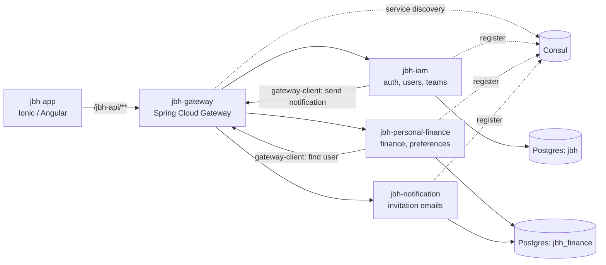

# JBH

JBH is a personal finance platform. Users track money movements, products and monthly balances.
Teams can share their finances, and invite members by email.

The system is built as microservices. Each service is its own repository.
It runs in production on a single VPS, with Docker Compose and Caddy.

## Architecture

- **One entry point.** The app calls only the gateway. The gateway checks the JWT and applies rate limits.
- **Service discovery.** Services register in Consul. The gateway finds them by name.
- **No direct calls between services.** They call each other through the gateway, with a shared Java client library.
  Each client has a circuit breaker (Resilience4j).
- **Auth.** JWT access tokens (15 min) and refresh tokens (30 days), in headers or secure cookies. Google sign-in.

## Repositories

| Repository | What it does | Tech |
|------------|--------------|------|
| [jbh-app](https://github.com/kkpa-jbh/jbh-app) | Web and mobile front end. | Ionic, Angular, Capacitor |
| [jbh-gateway](https://github.com/kkpa-jbh/jbh-gateway) | Single API entry point: routing, JWT check, rate limit. | Kotlin, Spring Cloud Gateway |
| [jbh-iam](https://github.com/kkpa-jbh/jbh-iam) | Login, users, teams, JWT. | Kotlin, Spring Boot, Spring Security, Gradle |
| [jbh-personal-finance](https://github.com/kkpa-jbh/jbh-personal-finance) | Finance and preferences. Modular monolith with hexagonal modules. | Java 21, Quarkus, Maven, Liquibase |
| [jbh-notification](https://github.com/kkpa-jbh/jbh-notification) | Notifications (team invitation emails). Also publishes the notification contracts. | Java 21, Quarkus, Maven, Liquibase |
| [jbh-gateway-client](https://github.com/kkpa-jbh/jbh-gateway-client) | Java library for service-to-service calls. | Java 21, Maven, Resilience4j |
| [jbh-commons-lib](https://github.com/kkpa-jbh/jbh-commons-lib) | Shared Java code for the Quarkus services. | Java 21, Maven |
| [jbh-deploy](https://github.com/kkpa-jbh/jbh-deploy) | Production deploy, local Docker stack, and the system map. | Docker Compose, Caddy, Make |

## Delivery

- **CI:** GitHub Actions builds each service and pushes a container image to GHCR, tagged with the git SHA.
- **Shared libraries** are published to GitHub Packages (Maven), in dependency order:
  `jbh-commons-lib` → `jbh-notification-contracts` → `jbh-gateway-client`.
- **Deploy:** the server only pulls images. A deploy that is not healthy rolls back by itself.
- **Edge:** Caddy serves HTTPS and the static app. Only the gateway and the web app are reachable from outside.
- **Databases:** PostgreSQL, with migrations that run at service start, and daily backups.
